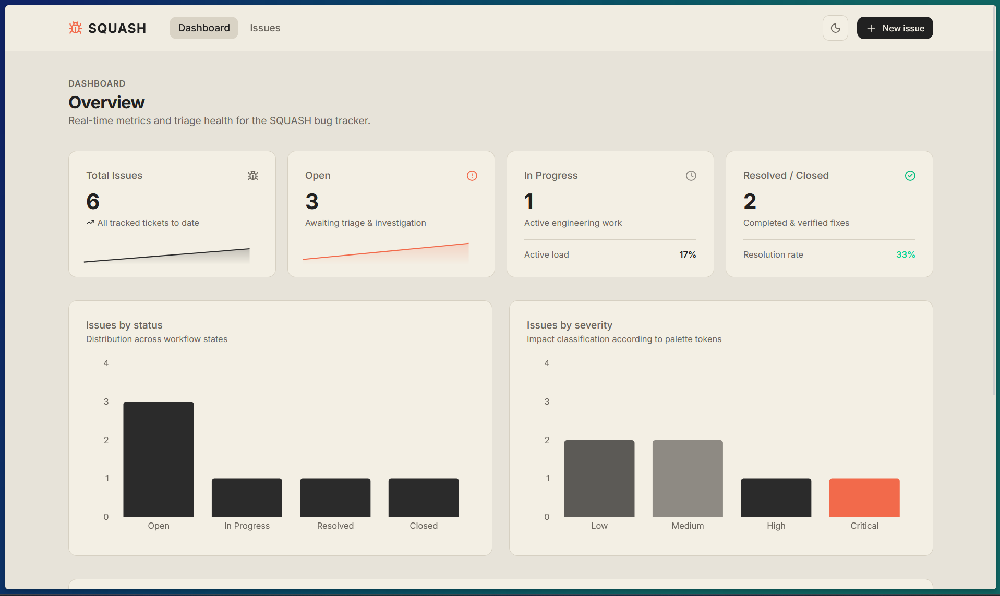
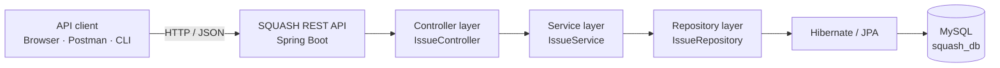
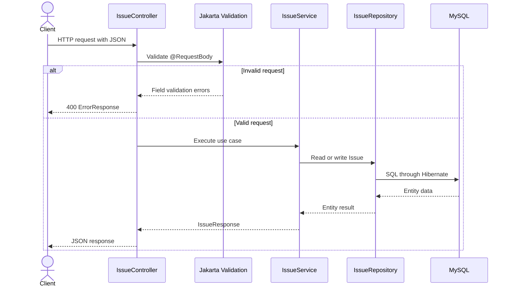
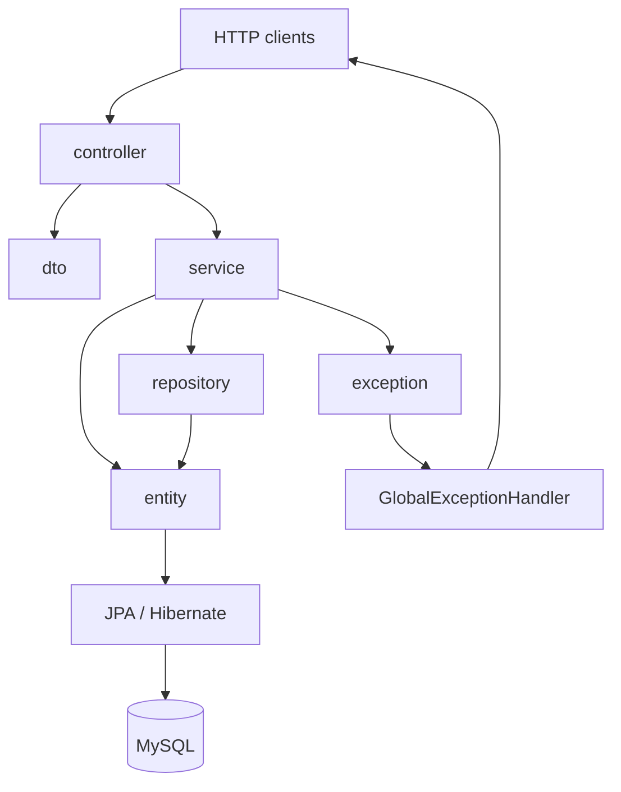
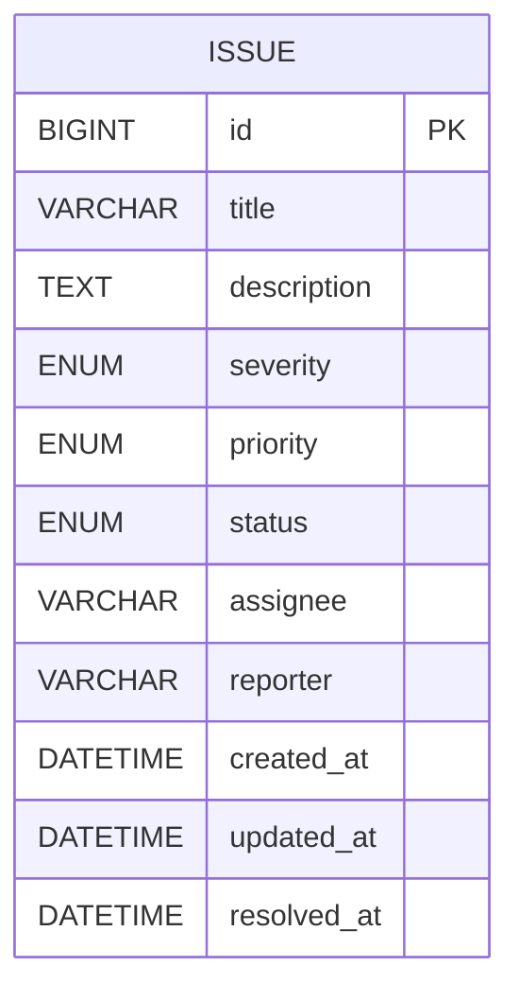
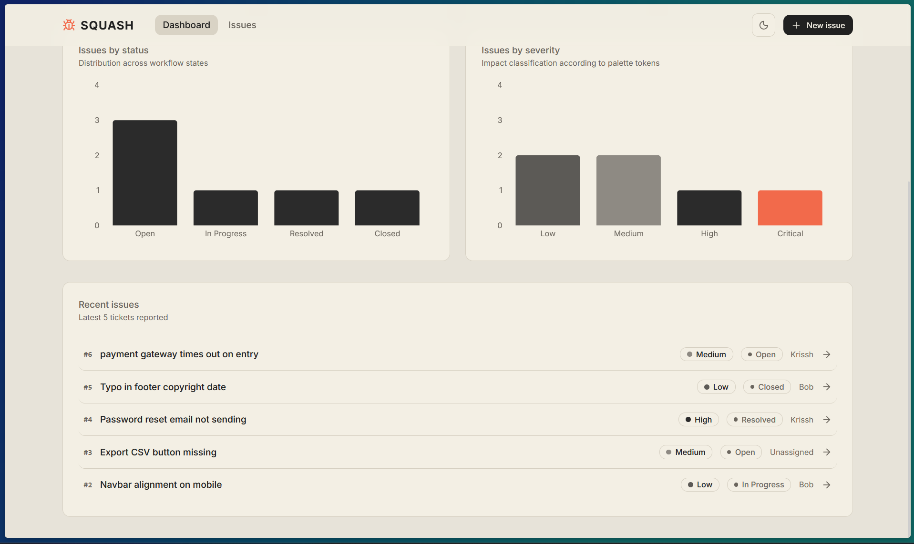
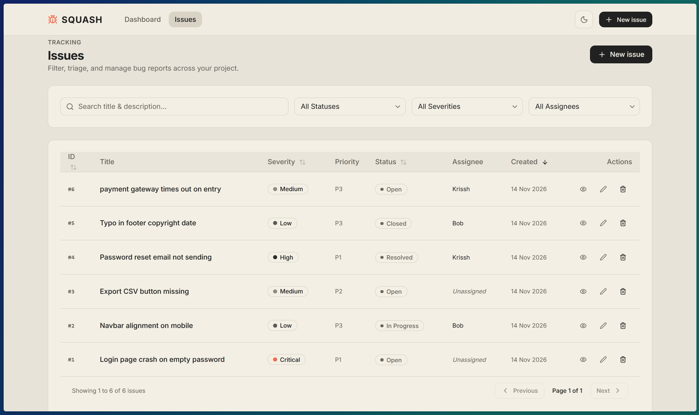
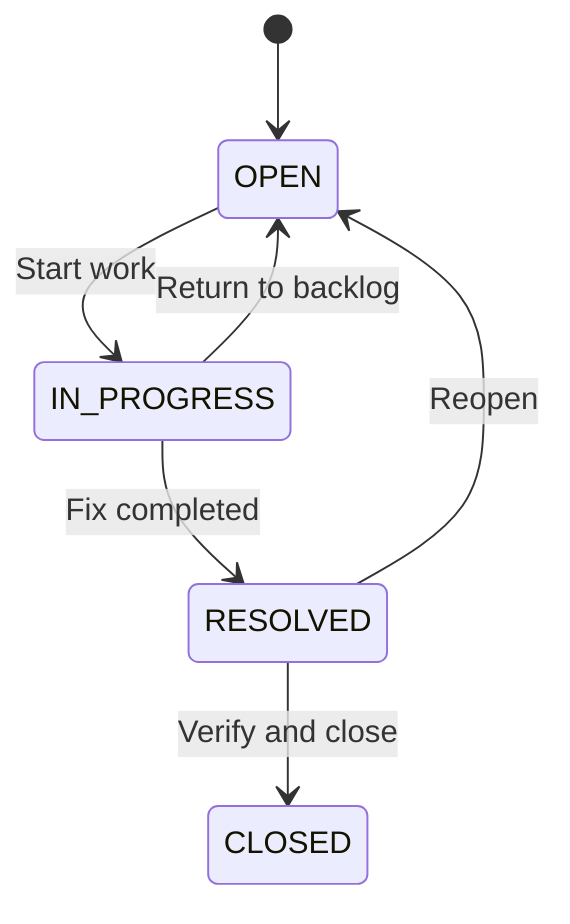
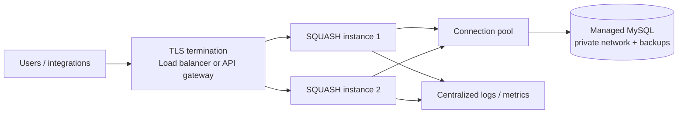

<div align="center">

# SQUASH

### A dependable issue-tracking REST API & modern web client for engineering teams


**SQUASH provides a clean HTTP API and a minimalist web application for reporting, triaging, assigning, searching, and resolving software issues.**

<br />



<br />

[Features](#features) · [Architecture](#architecture) · [Getting Started](#getting-started) · [Frontend](#frontend) · [API Reference](#api-reference) · [Deployment](#deployment)

</div>

---

## Contents

1. [Overview](#overview)
2. [Features](#features)
3. [Technology Stack](#technology-stack)
4. [Architecture](#architecture)
5. [Domain Model](#domain-model)
6. [Repository Structure](#repository-structure)
7. [Getting Started](#getting-started)
8. [Configuration](#configuration)
9. [API Reference](#api-reference)
10. [Error Handling](#error-handling)
11. [Status Workflow](#status-workflow)
12. [Production Operations](#production-operations)
13. [Security](#security)
14. [Testing Strategy](#testing-strategy)
15. [Known Limitations and Roadmap](#known-limitations-and-roadmap)
16. [Contributing](#contributing)
17. [License](#license)
18. [Author](#author)

---

## Overview

SQUASH is a Spring Boot REST service that centralizes issue tracking for a software project. It models an issue with a severity, priority, lifecycle status, reporter, assignee, and audit timestamps.

The application follows a layered architecture:

- **Controller layer** exposes versionless HTTP endpoints and validates request bodies.
- **Service layer** owns business rules, status transitions, filtering, search, and statistics.
- **Repository layer** persists entities through Spring Data JPA.
- **Database layer** stores issues in MySQL using Hibernate ORM.
- **Exception layer** converts domain and validation failures into consistent JSON responses.

The current implementation is intentionally focused on a single bounded context: issue management. Authentication, authorization, comments, attachments, notifications, and project tenancy are planned extensions rather than silently implied capabilities.

## Features

| Area | Capability |
| --- | --- |
| Issue lifecycle | Create, retrieve, update, assign, delete, resolve, close, and reopen issues |
| Classification | Severity levels `LOW`, `MEDIUM`, `HIGH`, and `CRITICAL` |
| Prioritization | Priorities `P1`, `P2`, and `P3`, with `P3` as the default |
| Filtering | Filter issues by status, severity, and assignee |
| Search | Case-insensitive title and description search |
| Statistics | Total issue count plus counts grouped by status and severity |
| Validation | Bean Validation for required fields and title length |
| Error contracts | Structured 400, 404, 409, and 500 responses |
| Seed data | Five sample issues are inserted only when the database is empty |
| API tooling | Ready-to-import Postman collection in `squash.postman_collection.json` |

## Technology Stack

| Layer | Technology | Responsibility |
| --- | --- | --- |
| Language | Java 17 | Application runtime and language features |
| Framework | Spring Boot 3.3.5 | Application bootstrapping and dependency management |
| Web | Spring Web MVC | REST controllers and HTTP response handling |
| Validation | Jakarta Bean Validation | Request validation |
| Persistence | Spring Data JPA and Hibernate | ORM and repository abstraction |
| Database | MySQL 8.0+ | Durable issue storage |
| Boilerplate reduction | Lombok | Getters, setters, builders, and constructors |
| Build | Apache Maven | Dependency management, compilation, tests, and packaging |
| API client | Postman | Manual endpoint verification |

## Architecture

### System context



Clients communicate only with the HTTP boundary. Database access is isolated behind the repository and service layers, preventing controllers from containing persistence or business rules.

### Request processing pipeline



### Package architecture



### Design principles

- Keep HTTP concerns in controllers and business decisions in services.
- Use DTOs at the API boundary instead of exposing persistence entities directly.
- Keep enum values explicit and stable for predictable client integration.
- Return structured errors so clients can distinguish validation, missing resources, conflicts, and server failures.
- Treat database credentials as deployment configuration, never as source-controlled application data.
- Make lifecycle changes explicit through a controlled status transition workflow.

## Domain Model

### Issue entity



| Field | Type | Rules |
| --- | --- | --- |
| `id` | `Long` | Auto-generated primary key |
| `title` | `String` | Required; maximum 150 characters |
| `description` | `String` | Optional; stored as database text |
| `severity` | `Severity` | Required |
| `priority` | `Priority` | Defaults to `P3` |
| `status` | `Status` | Defaults to `OPEN`; create requests always start as `OPEN` |
| `assignee` | `String` | Optional |
| `reporter` | `String` | Required |
| `createdAt` | `LocalDateTime` | Set by Hibernate on creation |
| `updatedAt` | `LocalDateTime` | Set by Hibernate on update |
| `resolvedAt` | `LocalDateTime` | Set when resolved; cleared when reopened |

### Enumerations

| Enumeration | Values |
| --- | --- |
| `Severity` | `LOW`, `MEDIUM`, `HIGH`, `CRITICAL` |
| `Priority` | `P1`, `P2`, `P3` |
| `Status` | `OPEN`, `IN_PROGRESS`, `RESOLVED`, `CLOSED` |

## Repository Structure

```text
SQUASH/
├── pom.xml
├── README.md
├── squash.postman_collection.json
├── frontend/
│   ├── .env.example
│   ├── package.json
│   ├── vite.config.js
│   ├── index.html
│   └── src/
│       ├── api/
│       │   └── issues.js
│       ├── components/
│       │   ├── issues/
│       │   │   ├── CreateIssueDialog.jsx
│       │   │   └── IssueDetailDrawer.jsx
│       │   ├── ui/
│       │   │   ├── Badge.jsx
│       │   │   ├── Button.jsx
│       │   │   ├── Card.jsx
│       │   │   ├── Dialog.jsx
│       │   │   ├── Drawer.jsx
│       │   │   ├── Input.jsx
│       │   │   ├── Select.jsx
│       │   │   ├── Skeleton.jsx
│       │   │   ├── Table.jsx
│       │   │   ├── Textarea.jsx
│       │   │   └── Toast.jsx
│       │   └── Navbar.jsx
│       ├── pages/
│       │   ├── Dashboard.jsx
│       │   └── Issues.jsx
│       ├── App.jsx
│       ├── index.css
│       └── main.jsx
├── src/
│   └── main/
│       ├── java/com/squash/
│       │   ├── SquashApplication.java
│       │   ├── config/
│       │   │   └── CorsConfig.java
│       │   ├── controller/
│       │   │   └── IssueController.java
│       │   ├── dto/
│       │   │   ├── AssignRequest.java
│       │   │   ├── IssueRequest.java
│       │   │   ├── IssueResponse.java
│       │   │   ├── StatsResponse.java
│       │   │   └── StatusUpdateRequest.java
│       │   ├── entity/
│       │   │   └── Issue.java
│       │   ├── enums/
│       │   │   ├── Priority.java
│       │   │   ├── Severity.java
│       │   │   └── Status.java
│       │   ├── exception/
│       │   │   ├── ErrorResponse.java
│       │   │   ├── GlobalExceptionHandler.java
│       │   │   ├── InvalidStatusTransitionException.java
│       │   │   └── IssueNotFoundException.java
│       │   ├── repository/
│       │   │   └── IssueRepository.java
│       │   └── service/
│       │       └── IssueService.java
│       └── resources/
│           ├── application.properties
│           └── application.properties.example
└── .gitignore
```

## Getting Started

### Prerequisites

- JDK 17 or newer
- Apache Maven 3.9 or newer, or an IDE with Maven support
- MySQL 8.0 or newer
- Git
- Optional: Postman for manual API testing

Verify the local toolchain:

```bash
java -version
mvn -version
mysql --version
```

### 1. Clone the repository

```bash
git clone https://github.com/Krissh360/SQUASH.git
cd SQUASH
```

### 2. Create the database

The configured JDBC URL can create the database automatically, but creating it explicitly is recommended for controlled environments:

```sql
CREATE DATABASE squash_db
  CHARACTER SET utf8mb4
  COLLATE utf8mb4_unicode_ci;
```

### 3. Configure the application

Copy the example configuration:

```bash
cp src/main/resources/application.properties.example src/main/resources/application.properties
```

Then set a real database username and password. The local configuration file is ignored by Git.

### 4. Run the application

```bash
mvn spring-boot:run
```

The API is available at:

```text
http://localhost:8080/api/issues
```

On the first successful startup against an empty database, the application inserts five sample issues. It does not replace existing rows.

### 5. Build and test

```bash
mvn clean test
mvn clean package
```

The executable JAR is created under `target/`.

### 6. Import the API collection

Import `squash.postman_collection.json` into Postman. The collection contains representative requests for creation, retrieval, filtering, searching, assignment, status changes, statistics, and deletion.

### 7. Run the Frontend client

```bash
cd frontend
npm install
npm run dev
```

The frontend web application will start at:

```text
http://localhost:5173
```

By default, the client talks to `http://localhost:8080`. To override the backend URL, copy `.env.example` to `.env` and set `VITE_API_URL`:

```bash
cp frontend/.env.example frontend/.env
```

## Frontend

The SQUASH web UI is built with **React 18**, **Vite**, **Tailwind CSS v4**, and **Recharts**. It provides a minimalist design with a default dark theme and an alternative warm light theme.

### Screenshots

#### 1. Dashboard Overview
Real-time KPI stat cards with trend sparklines, distribution bar charts for workflow statuses and severity levels:

<p align="center">
  
</p>

#### 2. Recent Issues & Triage
Quick-access recent tickets with severity badges, status, and direct drawer access:

<p align="center">
  
</p>

#### 3. Issues Tracking & Filters
Filter by combined criteria (status, severity, assignee), instant debounced keyword search, multi-column sorting, and pagination:

<p align="center">
  
</p>

### Key capabilities:
- **Dashboard (`/`)**: Real-time KPI stat cards with trend sparklines (Total, Open, In Progress, Resolved/Closed), distribution bar charts for workflow statuses and severity levels, and quick-access recent tickets.
- **Issues (`/issues`)**: Filter by combined criteria (status, severity, assignee), instant debounced keyword search across title and description, multi-column sorting, and 10-per-page pagination.
- **Create & Edit modal**: Client-side validation mirroring backend constraints (title max 150, required fields) and structured 400 error reporting.
- **Issue detail drawer**: Slide-out panel inspecting full issue history and timestamps, one-click assignee updating, delete confirmation, and workflow actions enforcing allowed status transitions (`OPEN` → `IN_PROGRESS` → `RESOLVED` → `CLOSED`).
- **Dark/Light theme toggle**: Persistent theme switch with strict design system token mapping.

### Running both servers together:

1. **Terminal 1 (Backend)**:
   ```bash
   mvn spring-boot:run
   ```
2. **Terminal 2 (Frontend)**:
   ```bash
   cd frontend
   npm run dev
   ```
3. Open `http://localhost:5173` in your browser.


## Configuration

The example configuration is intentionally safe to commit:

```properties
spring.datasource.url=jdbc:mysql://localhost:3306/squash_db?createDatabaseIfNotExist=true&useSSL=false&serverTimezone=UTC
spring.datasource.username=root
spring.datasource.password=change-me
spring.jpa.hibernate.ddl-auto=update
spring.jpa.show-sql=true
spring.jpa.properties.hibernate.format_sql=true
```

### Configuration guidance

| Property | Local development | Production guidance |
| --- | --- | --- |
| `spring.datasource.url` | Local MySQL URL | Use a managed database endpoint and TLS |
| `spring.datasource.username` | Local development user | Use a least-privilege service account |
| `spring.datasource.password` | Local secret | Inject through a secret manager or environment |
| `spring.jpa.hibernate.ddl-auto` | `update` for convenience | Use migrations and set to `validate` |
| `spring.jpa.show-sql` | `true` while debugging | Disable to avoid noisy or sensitive logs |
| `spring.jpa.properties.hibernate.format_sql` | Helpful locally | Enable only when SQL readability is needed |

For production, do not place credentials in `application.properties`, Docker images, shell history, or source control. Prefer environment-specific configuration, secret injection, encrypted connections, and connection-pool limits.

## API Reference

Base URL:

```text
http://localhost:8080/api
```

### Endpoint summary

| Method | Endpoint | Purpose | Success |
| --- | --- | --- | --- |
| `POST` | `/issues` | Create an issue | `201 Created` |
| `GET` | `/issues` | List and filter issues | `200 OK` |
| `GET` | `/issues/{id}` | Retrieve one issue | `200 OK` |
| `PUT` | `/issues/{id}` | Replace editable issue details | `200 OK` |
| `DELETE` | `/issues/{id}` | Delete an issue | `204 No Content` |
| `PATCH` | `/issues/{id}/status` | Move an issue through its workflow | `200 OK` |
| `PATCH` | `/issues/{id}/assign` | Assign an issue | `200 OK` |
| `GET` | `/issues/severity/{severity}` | List by severity | `200 OK` |
| `GET` | `/issues/search?keyword=...` | Search title and description | `200 OK` |
| `GET` | `/issues/stats` | Return aggregate counts | `200 OK` |

### Create an issue

```http
POST /api/issues
Content-Type: application/json
```

```json
{
  "title": "Payment gateway timeout",
  "description": "Checkout times out when the payment provider is slow.",
  "severity": "HIGH",
  "priority": "P1",
  "reporter": "Alice"
}
```

`status` is not accepted in the request DTO. New issues always start as `OPEN`.

Example response:

```json
{
  "id": 6,
  "title": "Payment gateway timeout",
  "description": "Checkout times out when the payment provider is slow.",
  "severity": "HIGH",
  "priority": "P1",
  "status": "OPEN",
  "assignee": null,
  "reporter": "Alice",
  "createdAt": "2026-11-13T12:00:00",
  "updatedAt": "2026-11-13T12:00:00",
  "resolvedAt": null
}
```

### List and filter issues

```http
GET /api/issues
GET /api/issues?status=OPEN
GET /api/issues?severity=CRITICAL
GET /api/issues?assignee=Krissh
GET /api/issues?status=IN_PROGRESS&severity=HIGH&assignee=Krissh
```

Filters are optional and can be combined. Status and severity values are case-sensitive enum names.

### Retrieve, update, assign, and delete

```http
GET /api/issues/6
PUT /api/issues/6
PATCH /api/issues/6/assign
DELETE /api/issues/6
```

Update body:

```json
{
  "title": "Payment gateway timeout after retry",
  "description": "The provider still times out after the retry policy runs.",
  "severity": "CRITICAL",
  "priority": "P1",
  "assignee": "Krissh",
  "reporter": "Alice"
}
```

Assignment body:

```json
{
  "assignee": "Krissh"
}
```

### Change status

```http
PATCH /api/issues/6/status
Content-Type: application/json
```

```json
{
  "status": "IN_PROGRESS"
}
```

### Search and statistics

```http
GET /api/issues/search?keyword=payment
GET /api/issues/severity/CRITICAL
GET /api/issues/stats
```

Example statistics response:

```json
{
  "total": 5,
  "byStatus": {
    "OPEN": 2,
    "IN_PROGRESS": 1,
    "RESOLVED": 1,
    "CLOSED": 1
  },
  "bySeverity": {
    "LOW": 2,
    "MEDIUM": 1,
    "HIGH": 1,
    "CRITICAL": 1
  }
}
```

## Error Handling

All handled failures use the `ErrorResponse` shape:

```json
{
  "timestamp": "2026-11-13T12:00:00",
  "status": 400,
  "error": "Validation Error",
  "message": "Input validation failed",
  "path": "/api/issues",
  "fieldErrors": {
    "title": "Title is required",
    "severity": "Severity is required"
  }
}
```

| Status | Meaning | Typical cause |
| --- | --- | --- |
| `400 Bad Request` | Validation failed | Missing required field or invalid request body |
| `404 Not Found` | Resource does not exist | Unknown issue ID |
| `409 Conflict` | Domain operation is not allowed | Invalid status transition |
| `500 Internal Server Error` | Unexpected server failure | Unhandled application or infrastructure failure |

The generic exception handler intentionally returns a safe public message rather than exposing internal stack traces. Production deployments should pair this with server-side structured logging and correlation IDs.

## Status Workflow



Allowed transitions:

- `OPEN` -> `IN_PROGRESS`
- `IN_PROGRESS` -> `RESOLVED`
- `IN_PROGRESS` -> `OPEN`
- `RESOLVED` -> `CLOSED`
- `RESOLVED` -> `OPEN`

Any other transition returns `409 Conflict`. Transitioning to `RESOLVED` sets `resolvedAt`; reopening from `RESOLVED` clears it.

## Production Operations

### Deployment topology



Recommended production controls:

1. Build an immutable JAR or container image in CI.
2. Inject configuration and secrets at deploy time.
3. Run at least one database migration or schema-validation step before rollout.
4. Place the application and database on private network paths where possible.
5. Terminate TLS at the edge and forward only encrypted internal traffic when required.
6. Configure database backups, restore drills, and retention policies.
7. Use rolling deployments with readiness checks and a rollback version.
8. Restrict database permissions to the application schema and required operations.

### Health and readiness

The current application does not yet expose Spring Boot Actuator health endpoints. Before production rollout, add Actuator and publish:

- Liveness: process and JVM availability.
- Readiness: application startup and database connectivity.
- Metrics: request latency, error rate, database pool utilization, and JVM health.
- Version/build information for deployment traceability.

### Logging and observability

Production logs should be structured and should include:

- Request method, route, status, duration, and correlation ID.
- Business operation and issue ID where relevant.
- Exception class and a safe diagnostic message.
- Deployment version and environment.

Never log passwords, database credentials, authorization tokens, or complete sensitive request bodies.

## Security

Current safeguards:

- Input validation through Jakarta Bean Validation.
- Database credentials excluded from the normal source workflow.
- Safe generic error text for unexpected exceptions.
- Explicit status transitions instead of unrestricted status mutation.

Before exposing this service to an untrusted network, add:

- Authentication and role-based authorization.
- TLS-only transport and secure HTTP headers.
- Request size, rate, and timeout limits.
- CORS policy restricted to known client origins.
- Database migrations and least-privilege credentials.
- Audit events for assignment, deletion, and lifecycle changes.
- Dependency vulnerability scanning and secret scanning in CI.
- Automated tests for authorization boundaries and malformed input.

## Testing Strategy

The project includes Spring Boot test dependencies and should grow through the following test layers:

| Layer | Scope | Recommended tooling |
| --- | --- | --- |
| Unit | Status transitions, mapping, validation edge cases | JUnit 5, Mockito |
| Web slice | Controller contracts and error responses | `@WebMvcTest`, MockMvc |
| Persistence | Entity mappings and repository behavior | `@DataJpaTest` |
| Integration | Full HTTP-to-MySQL behavior | `@SpringBootTest`, Testcontainers |
| Contract | Stable JSON shapes and enum values | Postman/Newman or OpenAPI tooling |
| Static checks | Formatting, dependency and vulnerability checks | Maven plugins and CI |

Useful local commands:

```bash
mvn test
mvn verify
mvn spring-boot:run
```

## Known Limitations and Roadmap

### Current limitations

- No authentication, authorization, or multi-tenant project boundary.
- No OpenAPI/Swagger contract generated from the source.
- No pagination exposed by the current controller.
- Filtering, search, and statistics currently load issues before processing; large datasets require database-side queries.
- No database migration tool is configured.
- No automated application tests are currently included in the repository.
- No Actuator health, metrics, tracing, or centralized audit event pipeline is configured.
- The seed runner is suitable for development, not as a production data initialization strategy.

### Suggested roadmap

1. Add repository-level query methods or Specifications for database-side filtering and pagination.
2. Add Flyway or Liquibase migrations and change production DDL mode to `validate`.
3. Add OpenAPI documentation and generated client examples.
4. Add authentication, authorization, and project/team ownership.
5. Add unit, web, persistence, and Testcontainers integration tests.
6. Add Actuator, structured logging, metrics, tracing, and correlation IDs.
7. Add comments, attachments, labels, due dates, and notification integrations.
8. Add CI quality gates for tests, dependency scanning, formatting, and container security.

## Contributing

1. Create a focused branch from `main`.
2. Make one logical change per commit.
3. Add or update tests for behavior changes.
4. Run `mvn test` and review the API contract.
5. Update this README when setup, behavior, or operational expectations change.
6. Open a pull request with a concise summary and verification steps.

## License

No license has been declared yet. Add a `LICENSE` file before distributing SQUASH outside its owning organization.

## Author

**Krissh Chhabra**
GitHub: [@Krissh360](https://github.com/Krissh360)
